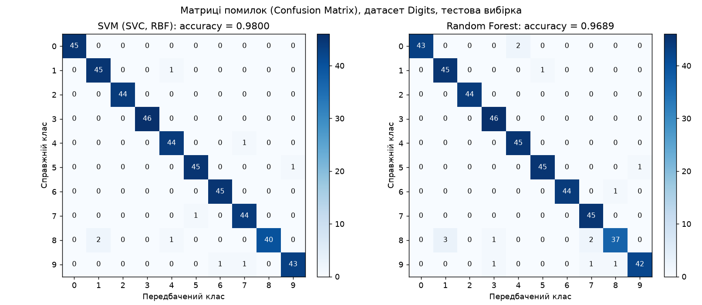
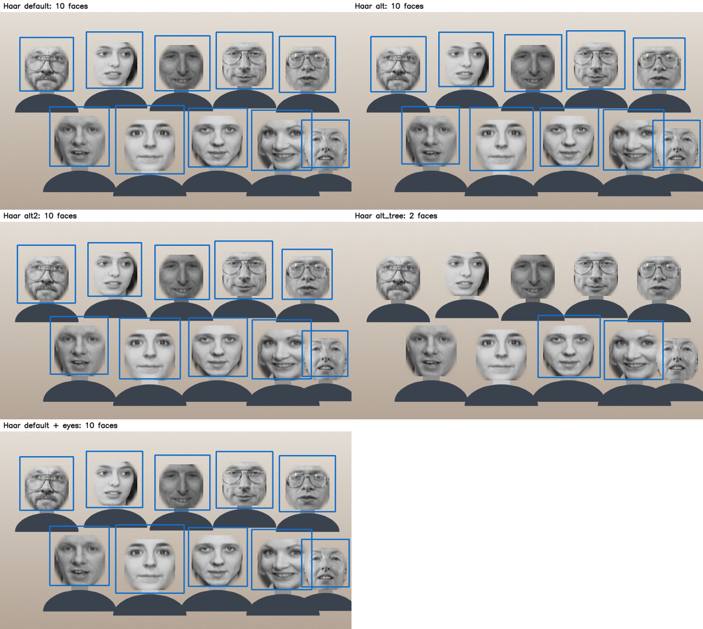
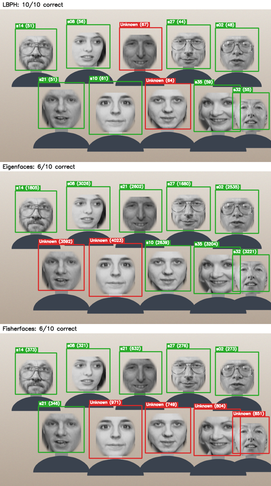

# 👤 Face Detection & Recognition + Classic ML

Classic machine learning with **scikit-learn** and computer vision with **OpenCV**:
digit classification, face detection on photos and video, and recognising people from a small face database.

> Built as a university lab (Lviv Polytechnic, "Scripting Languages", lab 7).

| Part | Command | What it does |
|---|---|---|
| Digits | `uv run lab7-digits` | SVM and Random Forest on the Digits dataset: classification report, confusion matrix, fit/predict time |
| Data | `uv run lab7-prepare` | builds a face database, a group photo and a video from the Olivetti (AT&T) dataset |
| Detection | `uv run lab7-detect` | face detection with 5 OpenCV detectors (Haar cascades, eye-verified variant) |
| Video | `uv run lab7-video` | face detection in video (`--webcam 0` for a webcam) |
| Recognition | `uv run lab7-recognize` | who is who on the group photo: LBPH, Eigenfaces, Fisherfaces |
| LSP | `uv run lab7-lsp` | Liskov Substitution Principle demo |

## Results

- **SVM (RBF):** accuracy **0.98** on 450 test digits, fit ≈ 36 ms, predict ≈ 23 ms





## Design

Three class hierarchies share one contract each: `ClassifierModel` (SVM, Random Forest),
`FaceDetector` (Haar cascades ×4, eye-verified detector), `FaceRecognizer` (LBPH, Eigenfaces, Fisherfaces).
Client code works only with the base classes, and the **same contract tests** in `tests/` run against
every subclass, which is how the code checks it follows LSP.

## Run

```bash
uv sync
uv run lab7-prepare
uv run devops-lab7        # everything in a row
uv run ruff check . ; uv run mypy src tests ; uv run pytest -v
```

**Stack:** Python 3.13 · scikit-learn · OpenCV · NumPy · matplotlib · pytest · mypy (strict) · ruff
